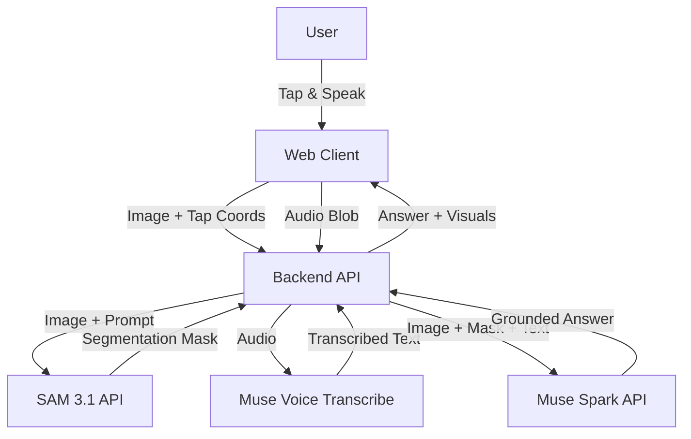

# System Architecture: LookWhere

## 1. High-Level Design
LookWhere is a client-server web application. The client handles camera input and user interaction, while the server orchestrates calls to the Meta Model API (SAM 3.1, Voice Transcribe, Muse Spark).



## 2. Components

### 2.1 Web Client (React + Vite)
- **Camera Module:** Uses `navigator.mediaDevices` to access the live feed.
- **Interaction Layer:** Captures tap coordinates relative to the video frame.
- **Visualizer:** Overlays segmentation masks/bounding boxes returned by the backend.
- **Audio Recorder:** Captures user questions via the MediaRecorder API.

### 2.2 Backend API (Node.js/Express or Python/FastAPI)
- **Orchestrator:** Manages the pipeline: Segmentation -> Transcription -> Reasoning.
- **Meta API Client:** Handles authentication and requests to Meta Model API.
- **Prompt Engineering:** Constructs the grounded prompt for Muse Spark using segmentation data.

### 2.3 Meta Model API Integration
- **SAM 3.1:** Receives the image and a point-prompt (from user tap). Returns pixel masks.
- **Muse Voice Transcribe:** Receives audio blob. Returns text with language detection.
- **Muse Spark:** Receives the original image, the segmentation mask, and the transcribed question. Returns a structured JSON answer.

## 3. Data Flow

1. **Capture:** User taps on an artifact in the camera view and speaks a question.
2. **Upload:** Client sends the current video frame (JPEG) and audio blob (WebM/WAV) to the backend.
3. **Segmentation:** Backend calls SAM 3.1 with the image and tap coordinates.
4. **Transcription:** Backend calls Voice Transcribe with the audio.
5. **Reasoning:** Backend constructs a prompt for Muse Spark:
   - *System:* "You are a museum guide. Describe ONLY the object highlighted by the segmentation mask."
   - *User:* [Transcribed Question]
   - *Context:* [Segmentation Mask Data]
6. **Response:** Muse Spark returns the answer. Backend forwards it to the client.

## 4. API Schema (Internal)

### POST /api/identify
**Request:**
```json
{
  "image": "base64_encoded_jpeg",
  "tapPoint": { "x": 0.5, "y": 0.3 },
  "audio": "base64_encoded_wav"
}
```

**Response:**
```json
{
  "mask": "base64_encoded_png", // Visual feedback
  "transcription": "What is this made of?",
  "answer": "This artifact is a terracotta lamp from the 4th century BCE...",
  "metadata": {
    "period": "4th Century BCE",
    "material": "Terracotta"
  }
}
```

## 5. Security & Privacy
- **Ephemeral Processing:** Images and audio are processed in memory and discarded immediately after the response.
- **API Key Management:** Meta API keys are stored in environment variables, never exposed to the client.
- **HTTPS:** All communication encrypted in transit.